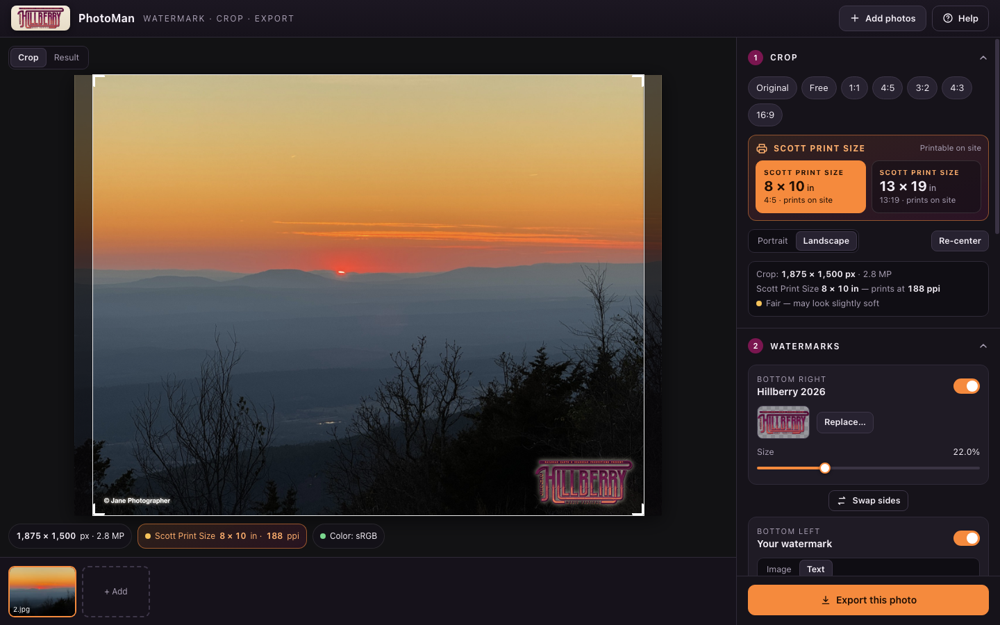

# Hillberry PhotoMan

**Watermark, crop and export festival photos at full quality, entirely in your browser.**

**▶ Use it online: <https://saccade-studio.github.io/hillberry-photoman/>**

**⬇ Or keep a copy that works with no internet at all:** open the site, then *Help → Download offline copy*. It is **one HTML file (about 500 KB)**: double-click it to open it in any modern browser, and send it to other photographers as-is. There is no install, server or account, and photos never leave the computer.



## What it does

- **Two watermarks, one consistent margin.** The Hillberry 2026 logo is bottom-right by default; the bottom-left is the photographer's own (upload a PNG/WebP/SVG with a transparent background, or type text). Sides can be swapped. A single *Edge margin* setting gives an identical gap on the left, right and bottom, measured from the logo's visible artwork rather than its empty padding.
- **Opacity and drop shadow.** Opacity, plus shadow strength, blur, distance, direction and color. *Light glow* is a one-click style that keeps the dark-plum logo readable on dusk and night photos.
- **Crop to standard sizes.** Original, Free, 1:1, 4:5, 3:2, 4:3, 16:9, and the two **Scott Print Sizes, 8 × 10 and 13 × 19, which are the sizes that can be printed on site**. For those, the panel shows the print resolution of your crop (for example "prints at 602 ppi, Excellent"). Crops are exact (a 4:5 crop is precisely 4:5), and Portrait/Landscape is chosen per photo.
- **Batches.** Drop photos or whole folders, then export one photo or all of them (a single .zip, or separate downloads). Files are named like `IMG_0412-Hillberry-8x10.jpg`.

## "Same quality, resolution and color space"

| | What happens |
|---|---|
| **Resolution** | Never resampled. The export is exactly the crop you chose, in the photo's own pixels. |
| **JPEG quality** | Default **100 with full 4:4:4 color detail**; the encoder works on un-rounded color values, so even at 100 there is no extra rounding step. "Optimize file size" shrinks files by ~10–15% with identical pixels. Max-quality files are typically 2–4× larger than a camera JPEG (quality 95 is about the same size as the original). |
| **Color space** | The embedded ICC profile (Adobe RGB, Display P3, ProPhoto, sRGB…) is read *without any conversion* and written back **byte-for-byte**. The sRGB watermark is converted into the photo's space first, so the logo's colors stay exact (pasting it unconverted would shift them by up to 60 levels in ProPhoto). Untagged photos are tagged sRGB. |
| **PNG** | Optional and fully lossless: the photo is bit-exact everywhere outside the watermark. |
| **Orientation** | EXIF rotation is applied to the pixels and the tag reset to 1, so nothing is ever rotated twice. |
| **Metadata** | Camera/lens/exposure, date, copyright and IPTC are kept (or location is removed, or everything). Size fields are corrected. The embedded thumbnail and MakerNote are dropped, because they would contain the *uncropped, un-watermarked* original. XMP packets are not carried over (they can hold stale crop/develop settings from Lightroom). |
| **Print size** | For Scott Print Sizes the file's DPI is set so it measures exactly the print size. |

This is done by code in this repository with no third-party libraries: a JPEG decoder (baseline and progressive, bit-exact with libjpeg), a JPEG encoder, and PNG, ICC, EXIF and ZIP writers. Browsers cannot reliably be told to skip color conversion, which is why export doesn't go through `canvas.toBlob()`.

Files the engine can't pass through directly (HEIC in Safari, WebP, TIFF, CMYK or LUT-profile JPEGs) are decoded by the browser and exported in Display P3 (or sRGB), tagged accordingly. The Export panel says when that happens.

## Privacy

Everything runs in the page. A [Content-Security-Policy](src/index.template.html) built into it forbids *all* network access, so the browser itself refuses any attempt to send data anywhere, and [a test](tests/ci-smoke.mjs) tries fetches, images, scripts, WebSockets and beacons to prove it. The hosted site is just a static file; it never receives your photos.

## Browsers

Tested opening the built file straight from disk (`file://`) and served like a Pages site, in **Chrome 154** and **Firefox 157** (Edge is Chromium). Safari uses the same standard APIs (16.4+ recommended for PNG export) but wasn't available to test; **Help → Run browser check** performs a real export round-trip and reports what works on any machine. Phones and tablets work (stacked layout, touch dragging), but very large photos (60 MP+) need a desktop's memory.

---

## Development

```
src/index.template.html, src/styles.css
src/core/   pure-compute modules, shared by the page and the export worker
            10-icc  20-jpeg-decode  30-jpeg-encode  40-meta (EXIF/IPTC)  50-png  60-marks (resample/shadow/layout)  70-zip  80-pipeline
src/app/    the UI: state, crop model, stage rendering, panel, export, self-test, about
assets/     the logo (embedded as base64), the README screenshot
build.mjs   inlines everything into dist/
tools/      dev helpers (Chrome DevTools + Firefox Marionette drivers, a static server)
tests/      regression suites
```

Preview and export share the same layout, resampling and shadow code, so what you see is what you get (the logo lines up to the pixel).

```sh
node build.mjs          # -> dist/index.html and dist/Hillberry-PhotoMan.html (identical single files)
npm run serve           # build, then serve dist/ at http://127.0.0.1:8765/hillberry-photoman/ (like Pages)
npm run test:unit       # portable unit tests (pure Node)
npm run test:smoke      # headless-Chrome smoke test: offline file, hosted site, offline-copy download, CSP proof
npm test                # everything below (macOS): builds, generates fixtures, runs every suite
```

The full suite compares the engine against independent tools: libjpeg's `djpeg`/`cjpeg` (the decoder is **bit-exact on 152 files**: baseline, progressive, restart markers, RGB-colorspace, 16-bit tables…), littleCMS via Pillow (colors within 1 level on 5 real profiles) and Apple's ImageIO. It also drives real Chrome and Firefox with real file pickers, mouse input and downloads. It needs Node ≥ 22, Python 3 with Pillow and numpy, libjpeg-turbo's `cjpeg`/`djpeg` (`brew install jpeg-turbo`) and the macOS ColorSync profiles; browser stages are skipped when Chrome/Firefox aren't installed. GitHub Actions runs the portable subset (`unit` + `smoke`) on every push.

## Deployment

`.github/workflows/pages.yml` builds the site and publishes `dist/` to GitHub Pages on every push to `main`. Setup is one switch: **Settings → Pages → Build and deployment → Source: GitHub Actions**. Dependabot keeps the actions current.

The site is the single file plus nothing else, so it works under any sub-path (a project site like `/hillberry-photoman/`) without configuration, and a downloaded copy behaves identically offline.

## License

No license file has been added, so by default all rights are reserved. The Hillberry artwork belongs to the festival and is not covered by anything in this repository's code.
